# Chef Rekt ($CHEFREKT) — launch-ready token package with a working AI agent

A complete wrapper for a Solana token whose product is an AI agent: paste a wallet address,
and an inspector reads its trades and files a restaurant-style review with stars.
Brand kit, a website built as a restaurant guide, the agent on a serverless function, X profile,
Telegram community and a launch package for pump.fun and DexScreener.

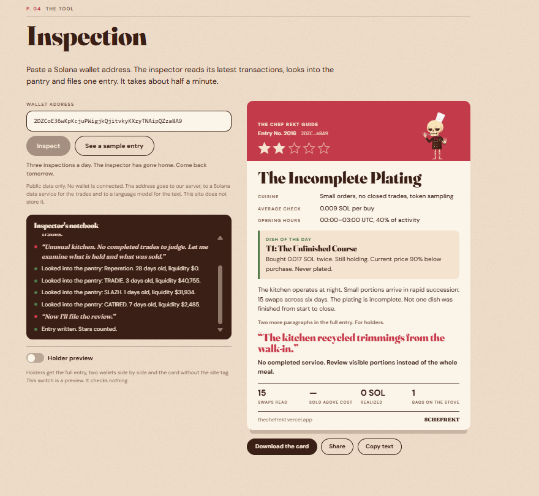

| | |
|---|---|
| **Type** | Token with an AI agent: wallet reviews from public chain data |
| **Chain** | Solana (pump.fun) |
| **Status** | Ready to launch. The token is not created. |
| **Time** | 4 hours, measured step by step (see `brand/docs/chefrekt_timelog.md`) |
| **Role** | Solo: brand, visuals, front-end, agent back-end, socials, community setup |
| **Website** | https://thechefrekt.vercel.app |
| **X** | https://x.com/thechefrekt |
| **Telegram** | https://t.me/thechefrekt |

## Idea

Every wallet on Solana is an open kitchen: anyone can see what was ordered, when, and how it ended.
Nobody reads it, because a list of transactions is not a story.

**Chef Rekt** reads it. He is a skeleton chef and a restaurant critic. He was a trader once, the market cooked him
down to the bones, and he kept the hat. Now he inspects wallets the way a guide inspects restaurants:
he arrives unannounced, reads every dish that left the kitchen and files an entry with stars.

- Slogan: *The blockchain remembers everything. Chef reads it out loud.*
- Second line: *Your wallet is already in the pan.*
- Voice: "restaurant critic". Dry, polite, short sentences: "Bold plating. Tastes like loss."

What the token is for: everyone gets the inspection (three a day), the short entry and the card with a small site tag.
Holders get the full entry, two wallets side by side and the card without the tag.
There is no token yet, so the site has a "Holder preview" switch that shows the holder mode without a wallet check.
The real balance check is on the roadmap and is not built.

The whole project plays one idea consistently: the site is a restaurant guide, every section is a page of it,
and the product is the inspector himself.

## 1. Character

Chef Rekt: a skeleton with a big round skull, heavy half-closed eye sockets, a dark brown double-breasted chef jacket,
a tall white hat, a red neckerchief and a sprig of rosemary in the chest pocket. Bare leg bones under the jacket.
The look is a flat editorial illustration, the kind a food magazine prints next to a review.

| Main reference | Turnaround |
|---|---|
|  |  |

Scenes for the website gallery and for posts.

| | | | |
|---|---|---|---|
|  |  |  |  |
|  |  |  |  |

Six poses, one for every rating from zero to five stars. They appear on the star scale and on every review card.

| 0 | 1 | 2 | 3 | 4 | 5 |
|---|---|---|---|---|---|
|  |  |  |  |  |  |

## 2. Brand kit

Palette "Steak": every color is taken from the plate.

| Element | Value |
|---|---|
| Background, cream (the fat) | `#F3E3CF` |
| Panels | `#FBF4E8` |
| Text, headings, buttons: dark brown (the crust) | `#3A1F16` |
| Meat red: stars, numbers, the review card | `#C7384A` |
| Cover red, matched to the illustrations | `#A13C4A` |
| Accent, rosemary green | `#4F7A4A` |
| Headings and ticker on the site | Fraunces |
| Body | DM Sans |

The ticker is always set in the heading font, so the `$` sign matches the letters next to it.
Plain numbers (steps, rules, the figures on the card) are set in the body font: the display font draws a flat-topped 3 that reads as a 5.

Exports, ready for every platform:

| File | Size | Used for |
|---|---|---|
| `brand/exports/chefrekt_avatar.png` | 1000×1000 | Token image, X and Telegram avatar |
| `brand/exports/chefrekt_avatar_circle.png` | 1000×1000 | Round logo |
| `brand/exports/chefrekt_avatar_circle_256.png` | 256×256 | Site logo, favicon |
| `brand/exports/chefrekt_x_header.png` | 1500×500 | X header |
| `brand/exports/chefrekt_dex_header.png` | 1500×500 | pump.fun banner, DexScreener header |
| `brand/exports/chefrekt_og.png` | 1200×630 | Link preview, Telegram portal, pinned post |

Two banners were made for two jobs: a close chase scene for the site and link previews,
and the same chase as a wide strip that fits a 3:1 header with room for the name.

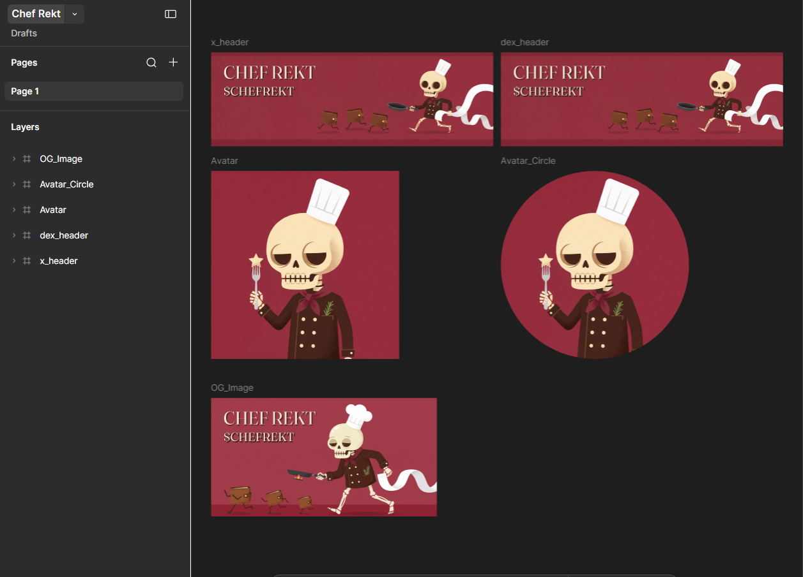

## 3. Website

https://thechefrekt.vercel.app

The site is a printed restaurant guide. There are eleven pages, and the page number follows the visitor in the corner of the screen.

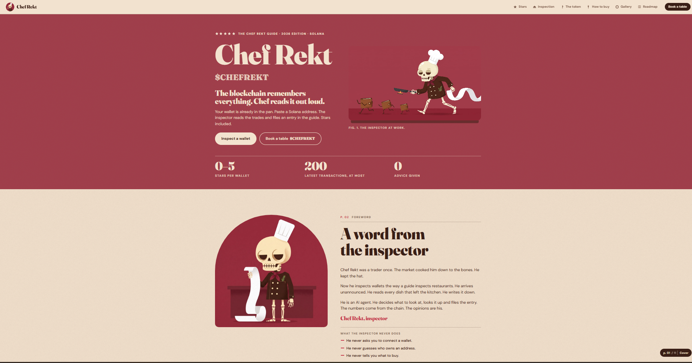

What happens on the page:

- **The cover.** The first screen is the cover of the guide: edition line with stars, the name, the slogan and the chase scene, which melts into the cover without a frame.
- **A menu of pictograms.** Star, cloche, knife, fork, plate, book. The current page is highlighted, and a marker in the corner says "p. 04 / 11 · Inspection".
- **The star scale.** Six rows from zero to five stars. The stars of a row light up one by one when it scrolls into view, and every rating has its own pose of the chef.
- **The inspector's notebook.** While the agent works, its steps appear as notes, one by one.
- **The entry.** The result is laid out as a guide entry: stars, cuisine, average check, opening hours, the dish of the day.
- **The label on the jar.** Tokenomics is printed as an ingredients label with heavy rules.
- **Plates.** The gallery is plates on a dark table with place cards. A tap opens the whole picture.
- **The reservation slip.** The buy button is a table reservation: two rows of choices, a "Confirmed" stamp, and the link behind it.

| The star scale | Plates |
|---|---|
| 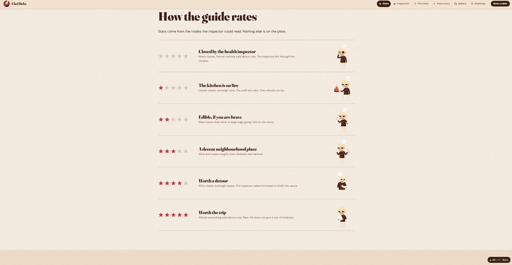 | 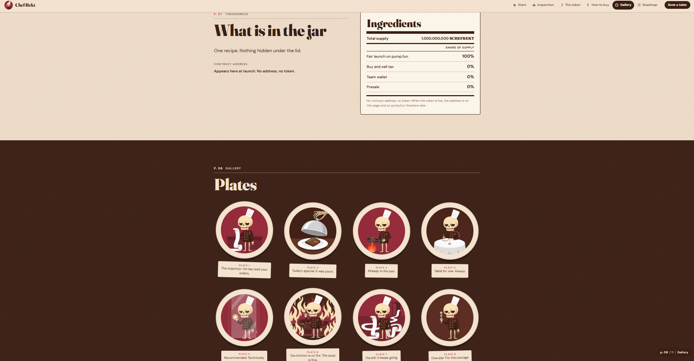 |

| Who gets what, how to buy | House rules |
|---|---|
| 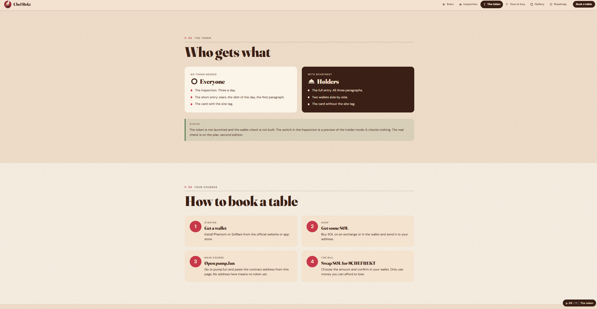 | 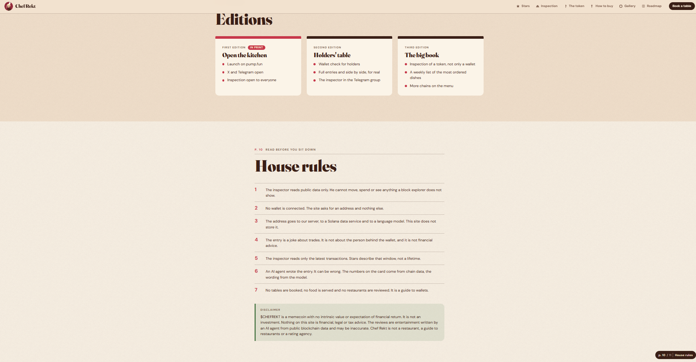 |

Static pages plus one serverless function, checked at five widths from 360 to 1440 px, auto-deploy on every push.
The effects respect the system "reduce motion" setting. Images are shrunk at build time: about 32 MB of originals become about 7 MB on the site.

### The Inspection: the agent

The visitor pastes a Solana wallet address. No wallet is connected.

1. **The agent decides what to do.** A language model runs in a loop with three tools: read the trades, look up a token, file the entry. It chooses which tokens deserve a closer look and when it has seen enough. Six turns at most.
2. **Its steps are visible.** The function streams every step to the page, and the notebook fills in while the agent works: "Read 200 transactions. Found 15 swaps in 5 tokens."
3. **The numbers come from code, not from the model.** Swaps, the share of positions sold above cost, realized result in SOL, bags still held, the busiest hours: all of it is computed from the transactions before the model sees anything. The model gets facts and writes the review; the figures printed on the card never pass through it.
4. **The entry.** Stars, an invented name for the establishment, cuisine, average check, opening hours, the dish of the day, three paragraphs, one line to quote.
5. **The card.** The entry is drawn as a 1080×1350 picture to download and share on X.

How it is built:

- **Data.** Parsed wallet history from Helius (up to 200 latest transactions), with a fallback to plain Solana RPC calls. Token details from the public DexScreener API.
- **A trade** is a transaction where the wallet's balance of exactly one token changed against SOL or a stablecoin. Transfers and airdrops are skipped.
- **Untrusted text stays out.** Token names are written by strangers on a public chain. Before they reach the model or the page they are cut to plain letters and digits, and the model sees short ids (`T1`…`T8`) instead of addresses. The entry is rendered as text, never as markup.
- **The agent cannot leave the card half empty.** An unfinished entry is sent back once for a rewrite; if gaps remain, they are written from the facts in plain sentences.
- **What the inspector never does** is in the prompt and on the site: he does not guess who owns a wallet, gives no advice and never calls a token safe. The review is about trades, not about a person.
- **Limits.** Three inspections a day in the visitor's browser, a per-address and a per-day counter on the server, same-site requests only. The keys live in the environment of the hosting project and never reach the browser.
- **When the agent is not reachable** (local preview, a deployment without keys), the button says why it cannot be pressed and the page offers a sample entry from the config: an invented wallet, marked as a sample on the page and on the card.
- **Tests.** `node tests/agent.test.mjs` runs the function against scripted answers of the three upstream services: the normal path, a forced entry, an empty wallet, the RPC fallback, a model outage, limits, an unfinished entry, and broken shapes of the entry.

"Holder preview" shows the full entry (three paragraphs instead of one), a side-by-side table of two wallets and the card without the site tag.

Everything comes from the project config and one persona file: the voice, the star scale, the labels, the sample entry.
Another agent with another character needs a new persona and new texts.

### Reusable template

The site is built from a template that lives in `templates/landing`.
A site is three files:

1. `project.config.json` — all texts, links and images of the project.
2. A theme file — colors, fonts, corner radius, overall look. This project uses the `steak` theme.
3. A layout file — which sections to show and in what order. This project uses the `guide` layout.

The agent is one function, `templates/landing/api/inspect.js`, deployed together with the site.
It answers only for projects that have a persona, so the other sites built from the same template are not affected.

```
cd templates/landing
npm install
PROJECT=chefrekt npm run dev
PROJECT=chefrekt npm run build
node tests/agent.test.mjs
```

## 4. X (Twitter)

- Profile: avatar, header, bio, link to the site.
- Pinned post: the chase scene and a warning that no contract address means no token.
- Content plan for 7 days, 12 posts with images and alt texts: [`launch/x_content.md`](launch/x_content.md). Four of them are scheduled.
- No price talk, no promises and no safety claims in any post. "Stars" and "review" are always about the trades of a wallet, never a rating of a token, a team or a person.

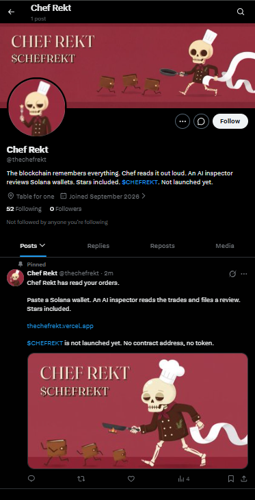

## 5. Telegram

- Public channel with a verification portal, private group for the chat.
- **Safeguard** — portal: entry to the group only after verification.
- **Rose** — welcome message with buttons, locks for links, forwards and bots, antiflood, automatic antiraid.
- One entry check on purpose: the portal. The captcha is kept in reserve for launch day.
- The full entry path is tested with a second account.
- Buy bot is connected on launch day, it needs a contract address.
- Full setup with all commands: [`launch/telegram.md`](launch/telegram.md).

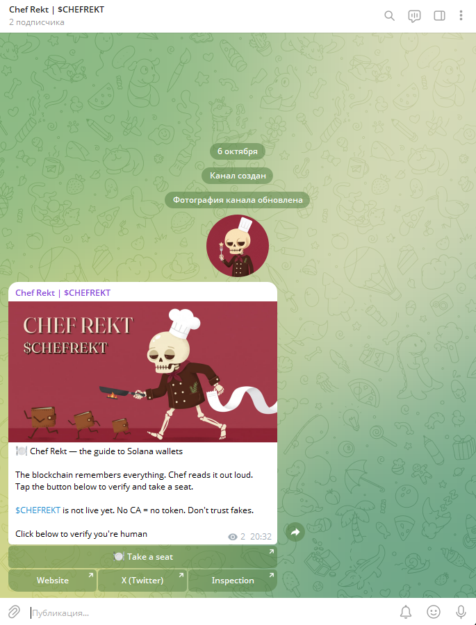

## 6. Launch package

Everything that is needed on launch day is prepared and checked against the live form:

- [`launch/pumpfun.md`](launch/pumpfun.md) — values for every field of the pump.fun form, file limits, checklist before and after creation.
- [`launch/dexscreener.md`](launch/dexscreener.md) — Enhanced Token Info: images, description, links.
- [`launch/telegram.md`](launch/telegram.md) — launch-day checklist for the community.

On pump.fun nothing can be edited after the coin is created.
That is why the site, X and Telegram are finished first, and the form was filled in a dry run without creating the coin.

| Form | Image and banner |
|---|---|
| 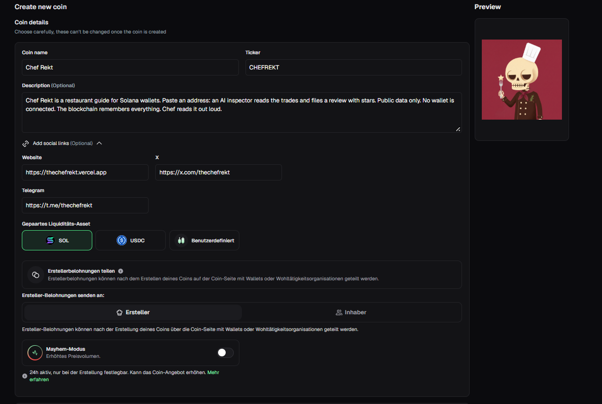 | 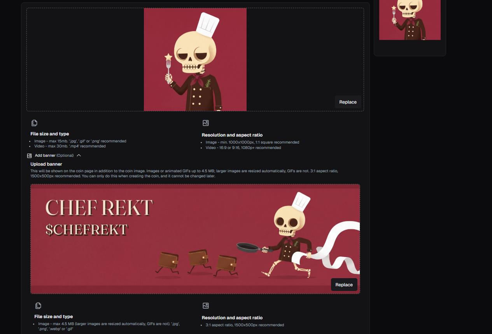 |

## Stack

| Area | Tools |
|---|---|
| Website | Astro, Tailwind CSS, TypeScript, Canvas, SVG |
| Agent | Vercel Functions (Node.js), a language model API with tool calling, streamed responses |
| Chain data | Helius, Solana RPC, DexScreener |
| Hosting | Vercel, auto-deploy from GitHub |
| Design | Figma |
| Community | Telegram, Rose, Safeguard |

## Folder structure

```
projects/chefrekt/
  project.config.json   texts, links, images for the site, labels and the sample entry of the agent
  brand/                references, logo, banners, exports, gallery, rating poses, docs
  launch/               pump.fun, DexScreener, X content plan, Telegram setup
  case/                 screenshots for this page
templates/landing/
  api/inspect.js        the function behind the Inspection
  api/_agent/           the agent loop, the persona, chain data, trading facts
  tests/                the agent against scripted upstream answers
```

## Not done on purpose, and not confirmed

- The token is not created. This project is a complete launch package.
- The wallet check for holders is not built. The site shows the holder mode with a preview switch and says so.
- The inspector reads the latest transactions only. Stars describe that window, not the lifetime of a wallet. The site says so.
- An AI agent writes the entry and it can be wrong. The numbers on the card come from chain data, the wording from the model.
- The counters that limit inspections live in the memory of the function. The real cap on spending is the limit set at the model provider.
- The agent does not trade, holds no wallet and has no key to any funds.
- No animation in this project: the motion is on the site itself.
- No volume bots, no paid trending, no paid boosts.

## Disclaimer

$CHEFREKT is a meme project made for fun. It is not an investment and not financial, legal or tax advice.
The reviews are entertainment written by an AI agent from public blockchain data and may be inaccurate.
Chef Rekt is not a restaurant, a guide to restaurants or a rating agency. No food is served and no tables are booked.

## Contact

**cosa_nostra** — Telegram: [@insider_gang](https://t.me/insider_gang)
