# Ten Keys ($TENKEYS) — launch-ready utility token package

A complete wrapper for a Solana token with a working product: a creator-fee split calculator that runs in the browser.
Brand kit, a website built as a vault door with ten locks, X profile, Telegram community
and a launch package for pump.fun and DexScreener.

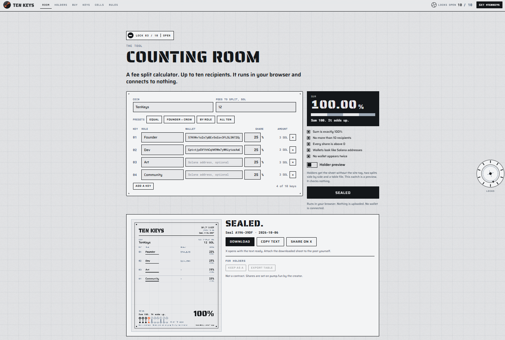

| | |
|---|---|
| **Type** | Utility token: a fee split calculator in the browser |
| **Chain** | Solana (pump.fun) |
| **Status** | Ready to launch. The token is not created. |
| **Time** | 4 hours, measured step by step (see `brand/docs/tenkeys_timelog.md`) |
| **Role** | Solo: brand, visuals, front-end, socials, community setup |
| **Website** | https://thetenkeys.vercel.app |
| **X** | https://x.com/thetenkeys |
| **Telegram** | https://t.me/thetenkeys |

## Idea

pump.fun lets a creator share the creator fees of a coin with other wallets after launch.
Most teams agree on the shares in a chat, after launch, when it is already late.

**Ten Keys** is the counting room for that conversation: set the shares, check that they add up to 100%,
seal the sheet and send the same sheet to everyone. Before launch.

- Slogan: *Agree on the split. Then launch.*
- Voice: "cold count". Numbers and short sentences, no exclamation marks: "40. 25. 20. 15. It adds up."
- No mascot. The brand is an object: ten keys to one vault, nine in steel and one in signal orange.

What the token is for: everyone gets the whole counting room, the sealed sheet with a small site tag and the text for the team chat.
Holders get the sheet without the tag, two splits side by side and the split as a table file.
There is no token yet, so the site has a "Holder preview" switch that shows the holder mode without a wallet check.
The real balance check is on the roadmap and is not built.

The whole project plays one idea consistently: the site is a vault door with ten locks, and every section is one lock.

## 1. Visuals

No character in this project. The recurring object is one key design: a flat ring-shaped bow, a long round shank
and a double-sided bit with square notches. It is shown as a clean product render: matte steel, light concrete,
soft studio light, and exactly one orange object in every picture.

| Key, top view | Key, angle |
|---|---|
| 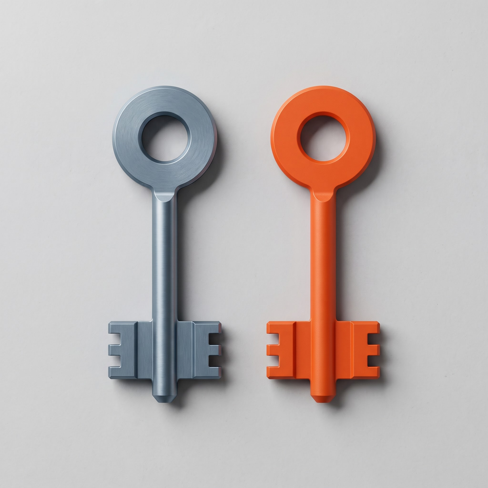 | 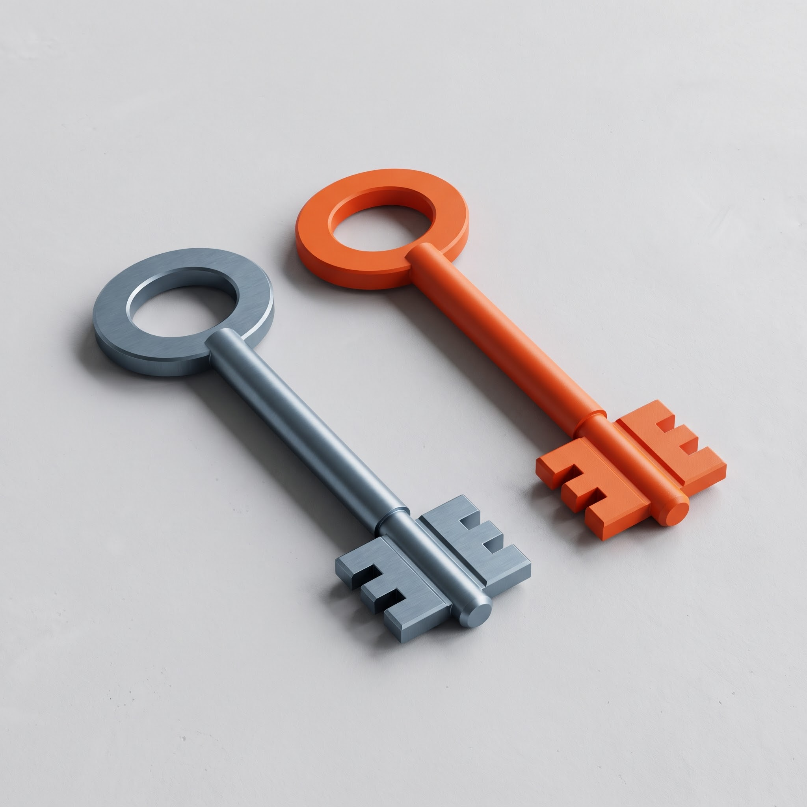 |

Scenes for the website gallery and for posts.

| | | |
|---|---|---|
| 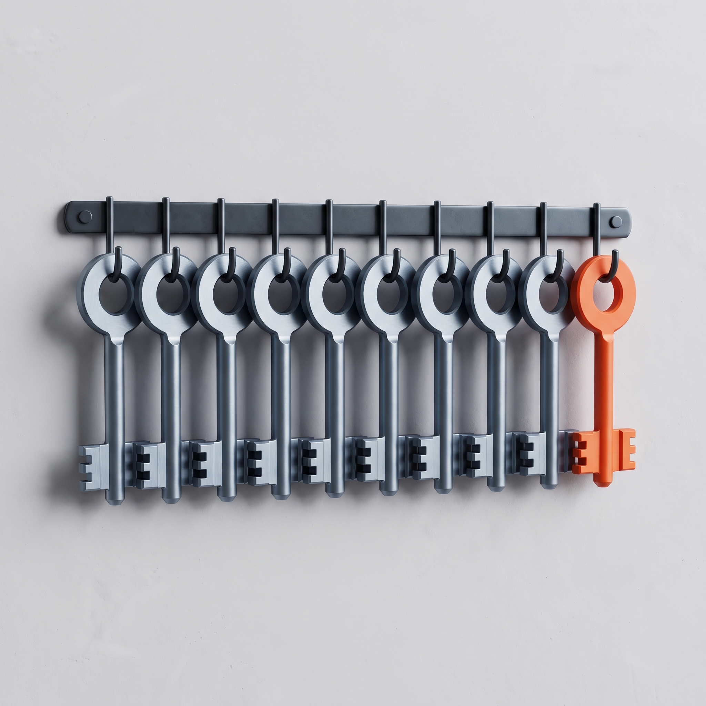 | 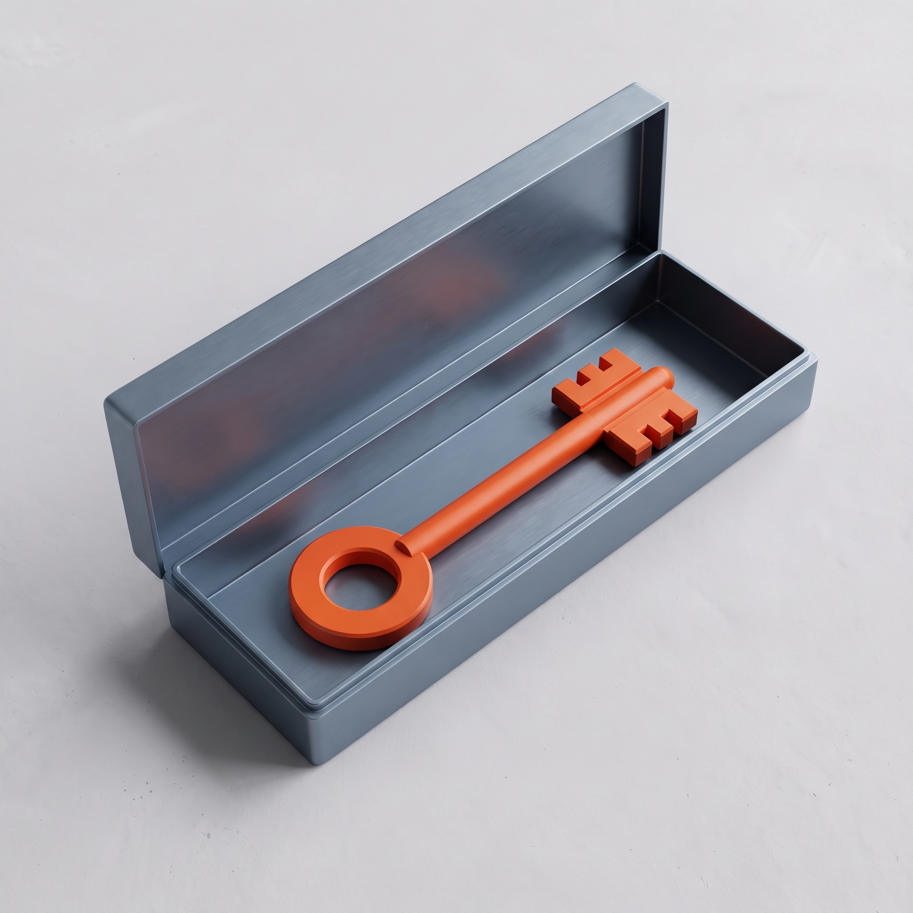 | 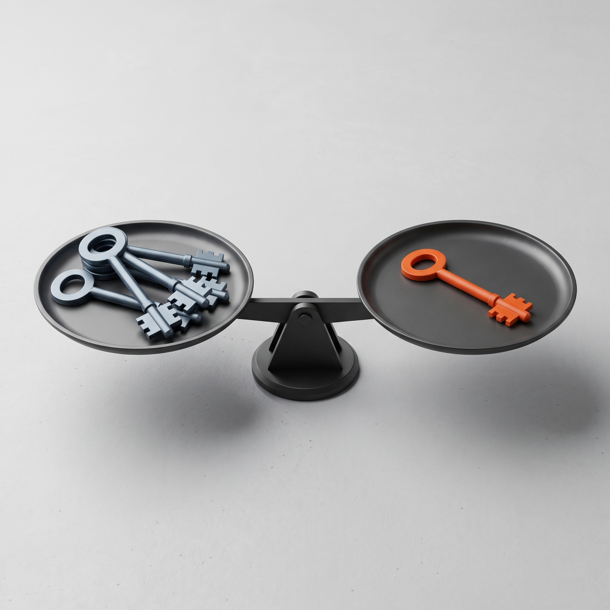 |
| 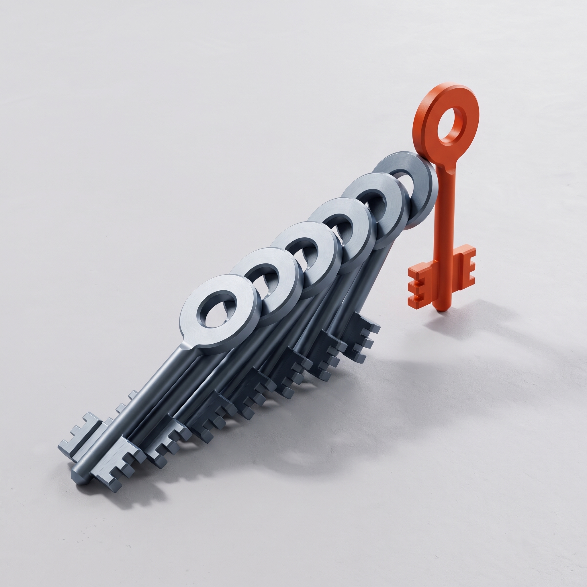 | 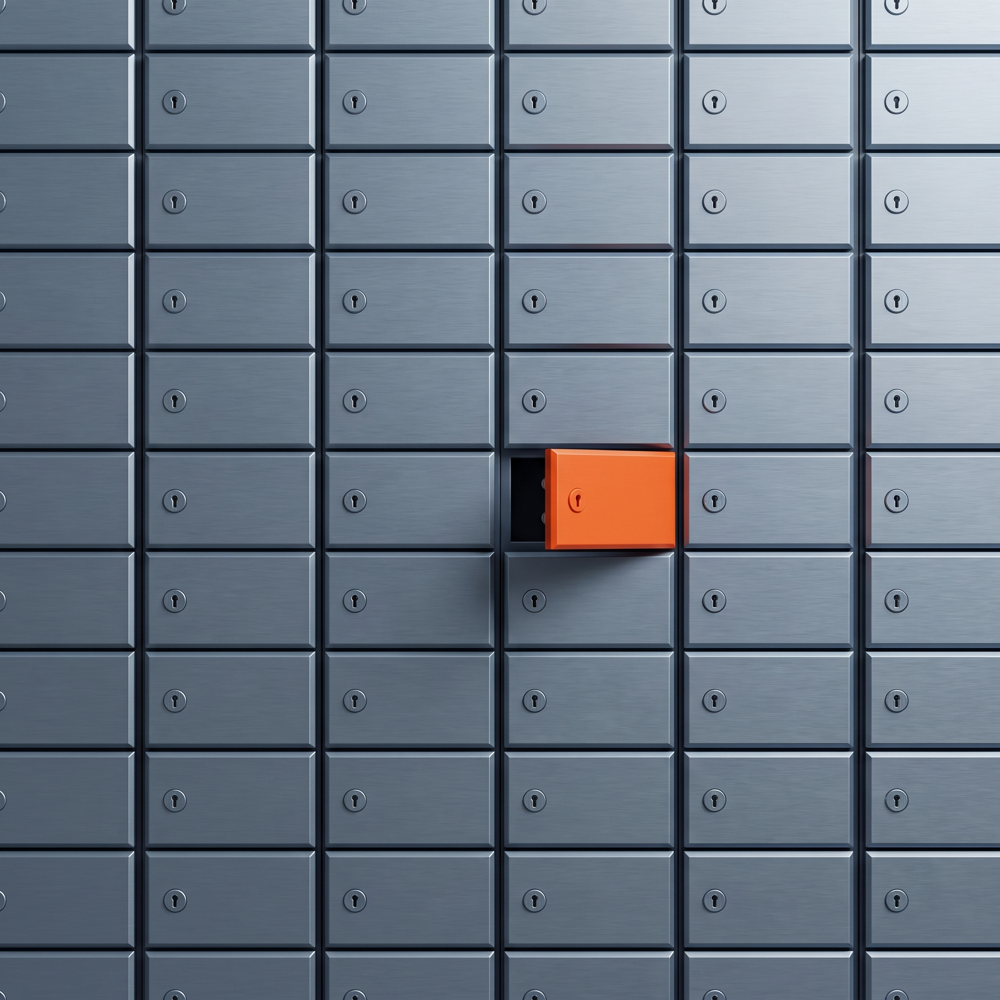 | 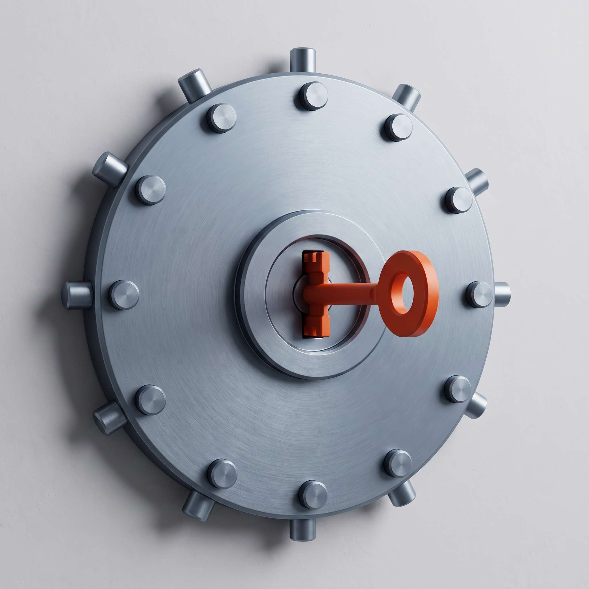 |

## 2. Brand kit

Palette "Concrete and signal": three greys and one signal color.

| Element | Value |
|---|---|
| Background, light concrete | `#E7E8EA` |
| Panels | `#F3F4F5` |
| Text, headings, buttons: dark steel | `#14171A` |
| Lines and captions: blue steel | `#4A6079` |
| Signal, one object per screen | `#FF5A1F` |
| Headings and ticker | Saira Stencil One |
| Body | Saira |
| Numbers and addresses | Roboto Mono |

The ticker is always set in the heading font, so the `$` sign matches the letters next to it.
The signal color is rationed: the main buttons are dark, and orange marks one thing at a time.

Exports, ready for every platform:

| File | Size | Used for |
|---|---|---|
| `brand/exports/tenkeys_avatar.png` | 1000×1000 | Token image, X and Telegram avatar |
| `brand/exports/tenkeys_avatar_circle.png` | 1000×1000 | Round logo |
| `brand/exports/tenkeys_avatar_circle_256.png` | 256×256 | Site logo, favicon |
| `brand/exports/tenkeys_x_header.png` | 1500×500 | X header |
| `brand/exports/tenkeys_dex_header.png` | 1500×500 | pump.fun banner, DexScreener header |
| `brand/exports/tenkeys_og.png` | 1200×630 | Link preview, Telegram portal |

Two banners were made for two jobs: a close scene at the lock panel for the site and link previews,
and a row of ten keys as a strip that fits a 3:1 header with room for the name.

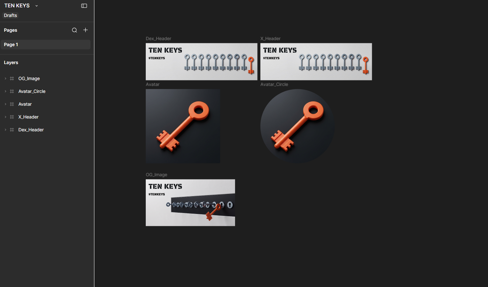

## 3. Website

https://thetenkeys.vercel.app

The site is a vault door with ten locks. There are ten sections, every section is one lock,
and a lock opens when the visitor reaches it.

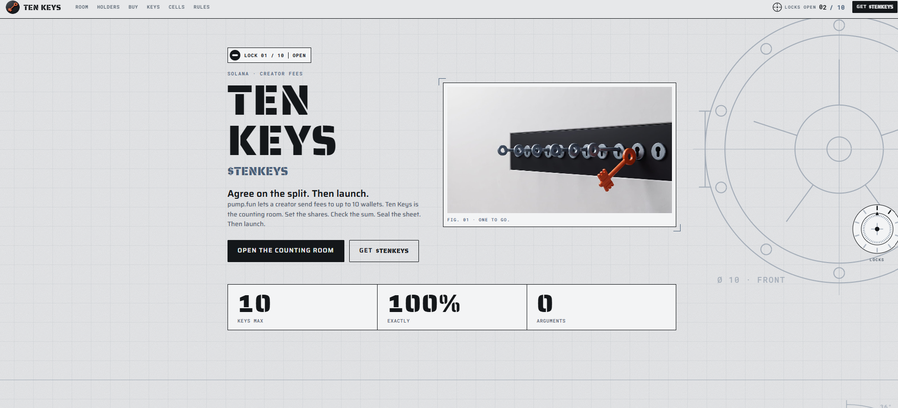

What happens on the page:

- **Lock counter.** The counter in the top bar goes from 01 to 10 while the page is scrolled. Opened locks stay open.
- **The dial turns with the scroll.** A small one in the bar, a large one at the side of wide screens, with one mark per lock.
- **Numbers roll like a mechanical counter.** Every big number on the page is a set of digit wheels.
- **Blueprints draw themselves.** Thin technical drawings in the background of the sections (the door, the key, a lock in section) are drawn line by line when they come into view.
- **One signal per screen.** Orange is used for exactly one object on every screen: one number, one key, one mark.
- **A wall of cells.** The gallery is a wall of deposit boxes. Each picture is behind a small steel door, and only one cell is open at a time.
- **Ten keys on a rack.** Tokenomics is a rack of ten keys. Pointing at a key or tapping it shows its share in the readout.
- **The status line.** A line at the bottom of the screen reports in the voice of the project: "Lock 4. Open. 6 left."

The last lock is the door itself: one bolt pulls back for every lock opened on the way down.
When all ten are open, the visitor turns the orange key, the wheel spins, the door swings, and the buy button is behind it.
The keyboard works, and there is a plain link that opens the door at once.

| The door | The rack of keys |
|---|---|
| 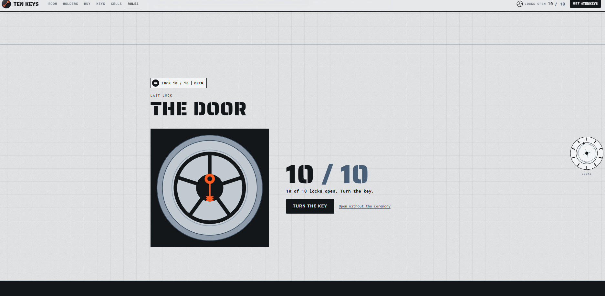 | 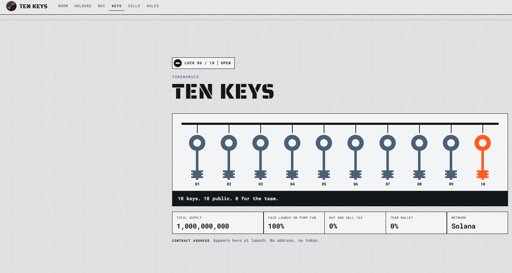 |

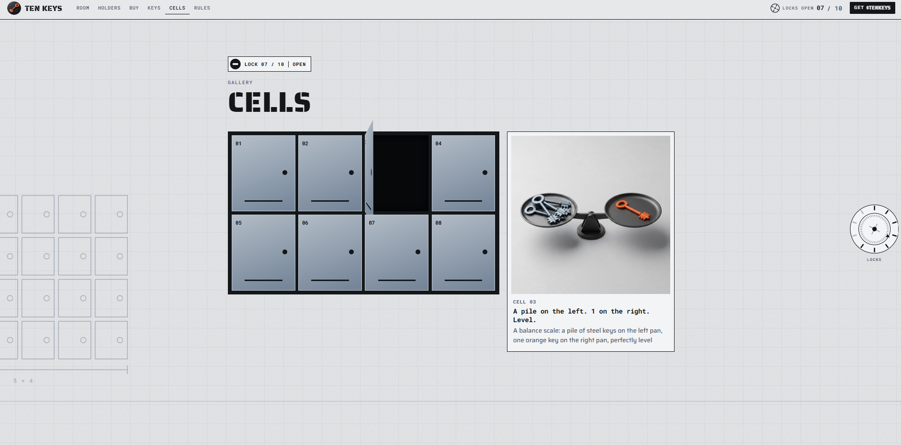

Static site, checked at five widths from 360 to 1440 px and on a phone, auto-deploy on every push. The effects respect the system
"reduce motion" setting. Images are shrunk at build time: about 19 MB of originals become about 4 MB on the site.

### The counting room

The tool works entirely in the browser. Nothing is uploaded or stored, and no wallet is connected.

1. **Rows.** Up to ten recipients: a role, an optional wallet and a share in percent. Presets fill the table in one tap: equal, founder and crew, by role, all ten.
2. **Checks.** The sum is exactly 100%, there are no more than ten recipients, no share is zero, every wallet looks like a Solana address and no wallet appears twice. When a check fails, the reason is written under the button with the numbers of the keys.
3. **Amounts.** Enter the fees in SOL and every row shows its amount.
4. **Seal.** The sheet is drawn as a 1200×1500 picture with a seal code made from its content: the same content always gives the same code, so two people can check that they hold the same sheet.
5. **Hand over.** Download the sheet, copy the text for the team chat (with full wallets), or open X with the text ready.

- Shares are kept as whole hundredths of a percent, so 33.34 + 33.33 + 33.33 is exactly 100. A comma works as a decimal sign.
- After any edit the sheet is marked as changed and has to be sealed again.
- "Holder preview" removes the site tag from the sheet and opens two holder tools: compare the current split with a kept one, and export the split as a table.
- Everything comes from the project config: starting rows, presets, limits and texts. The tool can be reused for another brand.
- Checked with an automated visitor on desktop and phone sizes: every button, every check, sealing, download, compare and export.

On the screenshot at the top of this page: a split of four keys, sealed, with the sheet ready to download.

### Reusable template

The site is built from a template that lives in `templates/landing`.
A site is three files:

1. `project.config.json` — all texts, links and images of the project.
2. A theme file — colors, fonts, corner radius, overall look. This project uses the `concrete` theme.
3. A layout file — which sections to show and in what order. This project uses the `vault` layout.

The list of locks, the status line, the rack, the rules and the whole counting room are plain data in the config,
so another site with a tool needs new texts and pictures only.

```
cd templates/landing
npm install
PROJECT=tenkeys npm run dev
PROJECT=tenkeys npm run build
```

## 4. X (Twitter)

- Profile: avatar, header, bio, link to the site.
- Pinned post: the lock panel and a warning that no contract address means no token.
- Content plan for 7 days, 12 posts with images and alt texts: [`launch/x_content.md`](launch/x_content.md). Four of them are scheduled.
- No price talk, no promises and no safety claims in any post. "Split" and "share" are always about how a team divides creator fees, never about returns.

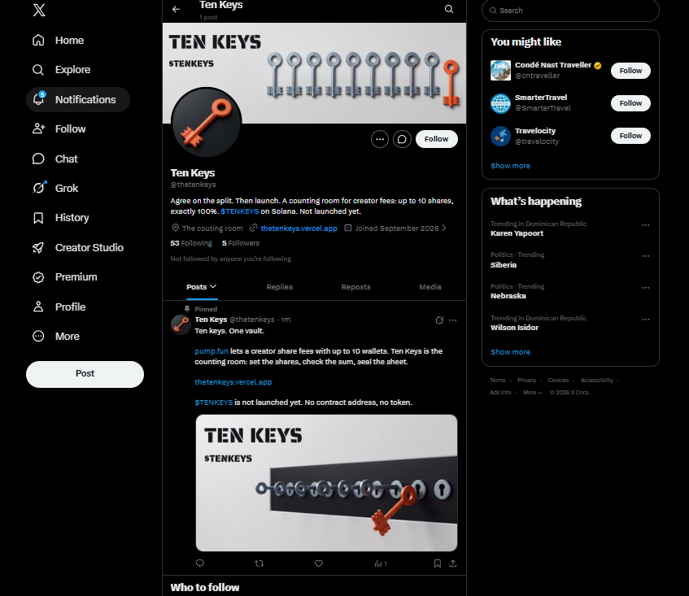

## 5. Telegram

- Public channel with a verification portal, private group for the chat.
- **Safeguard** — portal: entry to the group only after verification.
- **Rose** — welcome message with buttons, locks for links, forwards and bots, antiflood, automatic antiraid.
- One entry check on purpose: the portal. The captcha is kept in reserve for launch day.
- The full entry path is tested with a second account.
- Buy bot is connected on launch day, it needs a contract address.
- Full setup with all commands: [`launch/telegram.md`](launch/telegram.md).

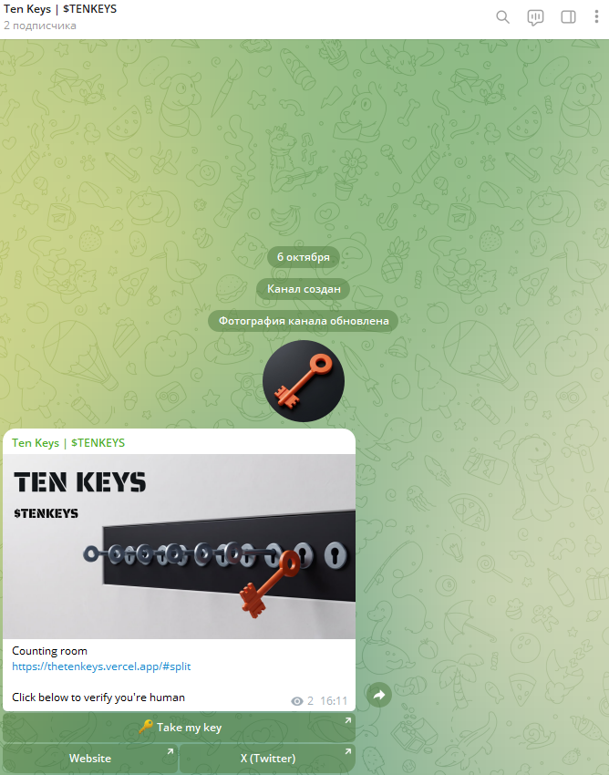

## 6. Launch package

Everything that is needed on launch day is prepared and checked against the live form:

- [`launch/pumpfun.md`](launch/pumpfun.md) — values for every field of the pump.fun form, file limits, checklist before and after creation.
- [`launch/dexscreener.md`](launch/dexscreener.md) — Enhanced Token Info: images, description, links.
- [`launch/telegram.md`](launch/telegram.md) — launch-day checklist for the community.

On pump.fun nothing can be edited after the coin is created.
That is why the site, X and Telegram are finished first, and the form was filled in a dry run without creating the coin.

| Form | Image and banner |
|---|---|
| 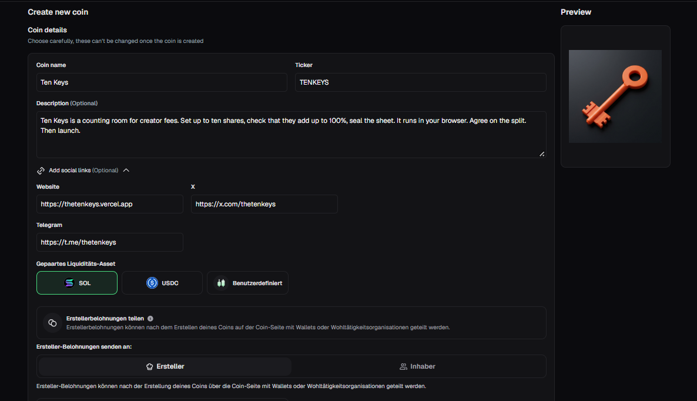 | 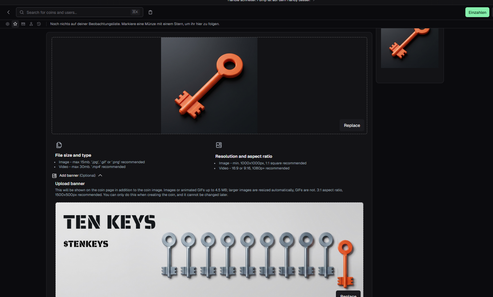 |

## Stack

| Area | Tools |
|---|---|
| Website | Astro, Tailwind CSS, TypeScript, Canvas, SVG |
| Hosting | Vercel, auto-deploy from GitHub |
| Design | Figma |
| Community | Telegram, Rose, Safeguard |

## Folder structure

```
projects/tenkeys/
  project.config.json   texts, links, images for the site
  brand/                references, logo, banners, exports, gallery, docs
  launch/               pump.fun, DexScreener, X content plan, Telegram setup
  case/                 screenshots for this page
```

## Not done on purpose, and not confirmed

- The token is not created. This project is a complete launch package.
- The wallet check for holders is not built. The site shows the holder mode with a preview switch and says so.
- The counting room does not set or move fees. Shares are set on pump.fun, and the sheet is not a contract. The site says both.
- "Up to ten wallets" comes from reports of January 2026. The live form, checked on 2026-10-06, confirms that creator rewards
  can be shared with other wallets after the coin is created, but it shows no number. The limit is one value in the config.
- No animation in this project: the motion is on the site itself.
- No volume bots, no paid trending, no paid boosts.

## Disclaimer

$TENKEYS is a meme project made for fun. It is not an investment and not financial or legal advice.
The split sheet is not a contract, and the site does not hold, move or distribute any fees. The counting room is free and runs in the browser.

## Contact

**cosa_nostra** — Telegram: [@insider_gang](https://t.me/insider_gang)
